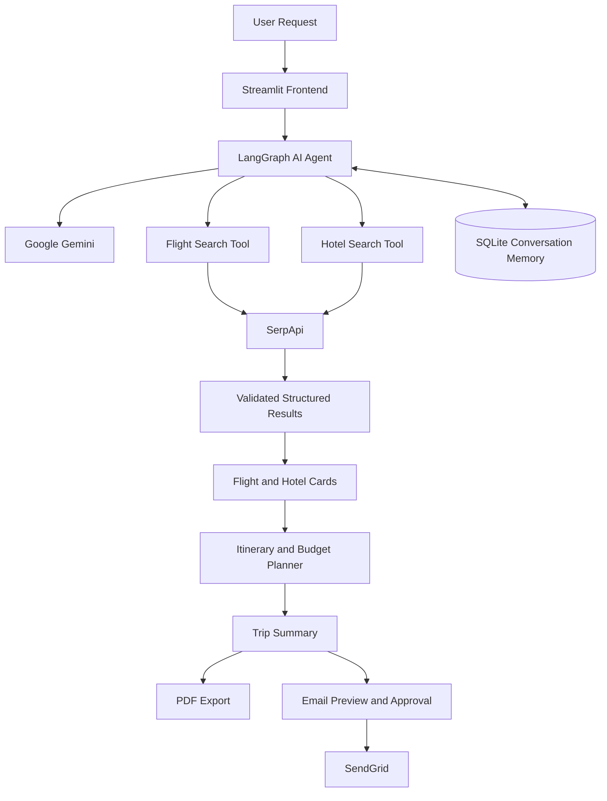

# ✈️ Wanderwise AI — Intelligent Travel Planner

**Plan smarter. Travel better. Explore more.**

Wanderwise AI is an AI-powered travel planning assistant built with **Streamlit, LangGraph, Google Gemini, and SerpApi**. It transforms natural-language travel requests into structured flight and hotel comparisons, personalized day-by-day itineraries, and transparent trip budget estimates.

With conversational memory, downloadable PDF reports, and optional email delivery, Wanderwise AI brings the essential steps of travel planning together in one interactive application.

> **Note:** Wanderwise AI helps you search and plan. It does not book flights, reserve hotels, or process payments.

---

## ✨ Features

### 🔎 Flight & Hotel Discovery
- Search flight options using SerpApi's Google Flights results.
- Discover hotels using Google Hotels search results.
- Display structured flight and hotel cards with available prices, dates, durations, stops, ratings, amenities, and provider links.
- Sort flight options by price, duration, and number of stops.
- Sort hotel options by price and guest rating.
- Handle missing provider data without fabricating prices, ratings, or availability.

### 🗺️ AI-Powered Trip Planning
- Generate personalized, day-by-day travel itineraries.
- Organize activities into morning, afternoon, and evening schedules.
- Estimate accommodation, transportation, food, activities, and contingency expenses.
- Compare the estimated trip cost against the user's budget.
- Use Gemini for itinerary generation, with a fallback when AI generation is unavailable.

### 💬 Conversational Memory
- Ask follow-up questions without repeating the entire trip request.
- Maintain conversation context using LangGraph checkpoints.
- Persist conversation state in SQLite.
- Start a fresh planning session using the **New Trip** control.

### 📄 PDF Reports & Email Delivery
- Generate downloadable PDF travel reports.
- Include trip details, flight and hotel results, itinerary, and budget estimates.
- Download a plain-text trip summary.
- Preview the email workflow and approve delivery explicitly.
- Send the PDF report using SendGrid when email credentials are configured.

### 🛡️ Reliability & Security
- Validate structured results with Pydantic.
- Keep API credentials in environment variables.
- Handle missing data and external API errors.
- Separate AI-generated suggestions from provider-sourced travel information.

---

## 🛠️ Technology Stack

| Component | Technology |
|---|---|
| Frontend | Streamlit |
| AI assistant | Google Gemini |
| Agent orchestration | LangGraph |
| LLM integration | LangChain Google GenAI |
| Flight search | SerpApi — Google Flights |
| Hotel search | SerpApi — Google Hotels |
| Data validation | Pydantic |
| Conversation persistence | SQLite + LangGraph Checkpointer |
| PDF generation | ReportLab |
| Email delivery | SendGrid |
| Configuration | Python Dotenv |
| Testing | Pytest |

---

## 🏗️ Architecture



### How it works

1. The user describes a trip using natural language.
2. The LangGraph agent interprets the request and invokes relevant search tools.
3. SerpApi retrieves available flight and hotel search results.
4. Results are normalized and validated before being displayed.
5. The user reviews options and generates a trip itinerary with estimated costs.
6. LangGraph checkpoints preserve conversation context for follow-up questions.
7. The user downloads a PDF report or approves sending it by email.

---

## 📁 Project Structure

```text
Wanderwise-AI/
│
├── frontend.py
├── requirements.txt
├── .env.example
├── .gitignore
│
├── app/
│   ├── agent.py
│   ├── tools.py
│   ├── schemas.py
│   ├── trip_planner.py
│   ├── memory.py
│   ├── pdf_service.py
│   └── email_service.py
│
└── travel_memory.sqlite3   # Generated locally
```

**Module responsibilities**

- `frontend.py` — Streamlit interface and user interactions.
- `app/agent.py` — Gemini integration and LangGraph agent execution.
- `app/tools.py` — Flight and hotel search integrations.
- `app/schemas.py` — Validated data models.
- `app/trip_planner.py` — Itinerary generation and budget calculations.
- `app/memory.py` — SQLite-backed conversation checkpoints.
- `app/pdf_service.py` — PDF report generation.
- `app/email_service.py` — Optional SendGrid email delivery.

The SQLite database and generated reports are runtime artifacts and should not be committed to Git.

---

## 🚀 Getting Started

### Prerequisites

- Python 3.11 or 3.12
- A Google Gemini API key
- A SerpApi API key for flight and hotel searches
- A SendGrid API key and verified sender address for email delivery (optional)
- Git, if cloning the repository

### 1. Clone the repository

```bash
git clone <YOUR_GITHUB_REPOSITORY_URL>
cd <YOUR_PROJECT_FOLDER>
```

Alternatively, download the project ZIP and extract it locally.

### 2. Create a virtual environment

**Windows — PowerShell**

```powershell
py -3.11 -m venv .venv
.\.venv\Scripts\Activate.ps1
```

If PowerShell blocks activation, use Command Prompt:

```cmd
.venv\Scripts\activate.bat
```

**macOS / Linux**

```bash
python3 -m venv .venv
source .venv/bin/activate
```

### 3. Install dependencies

```bash
python -m pip install --upgrade pip
pip install -r requirements.txt
```

### 4. Configure environment variables

Create a `.env` file in the project root. If `.env.example` exists, copy it and fill in your credentials.

```dotenv
# Google Gemini
Google_API_KEY=your_gemini_api_key
Google_MODEL=gemini-3.5-flash-lite

# SerpApi
SERPAPI_API_KEY=your_serpapi_api_key

# Optional: SendGrid email delivery
SENDGRID_API_KEY=
FROM_EMAIL=

# Optional: SQLite checkpoint database
TRAVEL_MEMORY_DB=travel_memory.sqlite3
```

**Important:** The itinerary module may also require `GOOGLE_API_KEY`. If so, configure the same Gemini key under both variable names:

```dotenv
GOOGLE_API_KEY=your_gemini_api_key
```

Use the exact variable names expected by your code. The model name above is configurable; choose a model currently available to your Gemini API account.

Never commit your real `.env` file or publish API credentials.

### 5. Run the application

From the project root:

```bash
streamlit run frontend.py
```

Open the local URL displayed in the terminal, usually:

**http://localhost:8501**

---

## 💡 Example Usage

### Example 1 — Flight and hotel search

```text
Find flights from DEL to BOM on 2026-11-15,
returning on 2026-11-20, for 1 adult.
Find 4-star hotels in Mumbai for the same dates.
```

### Example 2 — International trip

```text
Find nonstop flights from DEL to DXB on 2026-12-10
for 2 adults.

Find 4-star hotels in Dubai from 2026-12-10
to 2026-12-14.
```

### Example 3 — Budget-aware itinerary

```text
Plan a 5-day Mumbai trip for one adult with a total
budget of ₹30,000, including return flights and a hotel.

Compare available flight and hotel options, recommend
a suitable combination, generate a day-wise itinerary,
and estimate the total trip cost.
```

### Example 4 — Follow-up conversation

After generating a trip plan, ask:

```text
Keep the same travel dates, but reduce my hotel budget
to ₹3,000 per night. Recalculate the total and update
the itinerary without changing the return flight date.
```

The assistant is designed to use the existing trip context when handling follow-up requests.

---

## 🧪 Testing

Run the automated tests from the project root:

```bash
pytest -q
```

For additional debugging output:

```bash
pytest -v
```

Test coverage should include:

- Flight and hotel result normalization.
- Sorting and missing-data handling.
- Budget calculations and itinerary date validation.
- Conversation persistence and new-trip isolation.
- PDF generation and download.
- Email approval, attachment handling, and error cases.

Tests that do not require live provider data should use mocked API responses to avoid unnecessary API usage.

---

## ⚙️ Configuration & Cost Optimization

Wanderwise AI integrates external APIs, so actual costs and limits depend on the provider accounts and selected models.

- Reuse search results where safe instead of repeating identical API requests.
- Keep prompts focused to reduce unnecessary token usage.
- Use deterministic Python functions for sorting and budget calculations.
- Monitor Gemini quotas and SerpApi search limits.
- Leave SendGrid credentials unset when email delivery is not required.
- Use a supported Gemini model configured for your API account.

Free-tier access, model availability, and quotas may change. Check the relevant providers' current documentation before deployment.

---

## 🐛 Troubleshooting

| Problem | What to check |
|---|---|
| Gemini API key missing | Check `.env` variable names and restart Streamlit. |
| Flight or hotel results unavailable | Verify `SERPAPI_API_KEY`, search parameters, and remaining quota. |
| Itinerary falls back to a template | Check Gemini credentials, model availability, quota, and application logs. |
| Conversation context is lost | Check thread ID reuse, checkpointer configuration, and SQLite persistence. |
| PDF generation fails | Verify ReportLab installation and inspect the traceback. |
| Email delivery fails | Verify SendGrid credentials, sender identity, permissions, and provider response. |
| SQLite dependency error | Activate the correct virtual environment and reinstall requirements. |
| `ModuleNotFoundError` | Confirm the working directory and that all dependencies are installed in the active environment. |

---

## 🔐 Security & Limitations

- Never commit API keys, `.env`, private conversation databases, or generated reports.
- Rotate any credentials accidentally exposed in source code or logs.
- Treat external search results and provider links as untrusted data.
- Display unavailable information rather than inventing prices, ratings, or booking links.
- Budget figures for food, activities, and local transport are estimates, not confirmed quotes.
- Verify fares, hotel classifications, cancellation policies, taxes, and availability with the provider before booking.
- An itinerary is an AI-generated recommendation; independently verify opening hours and travel times.
- Email provider acceptance does not guarantee inbox delivery.
- The default SQLite checkpoint setup is intended for local or single-instance use. Add authentication, user isolation, and suitable persistent storage before deploying to multiple users.

---

## 🔮 Future Improvements

Potential extensions include:

- Interactive maps and route optimization.
- Weather-aware itinerary recommendations.
- Flight and hotel price monitoring with notifications.
- Saved trips and user profiles.
- Group travel planning and shared budgets.
- Multi-agent planning for flights, hotels, itinerary, and budgeting.
- Authentication and production-ready persistent storage.

---

## 👨‍💻 Built With

Wanderwise AI combines conversational AI, external travel search, persistent agent state, structured data validation, and document generation to make travel planning more organized and accessible.

**Wanderwise AI — From travel ideas to a structured trip plan.**
